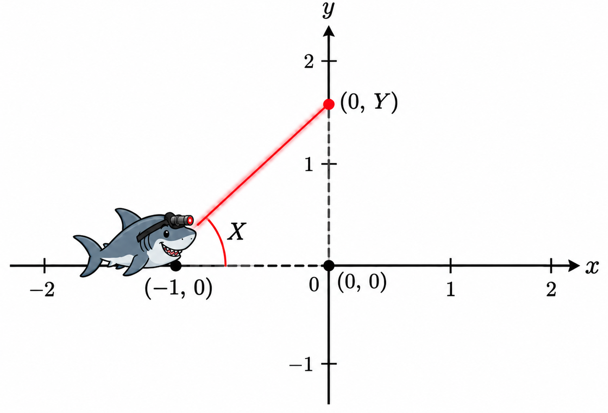

Let $X$ be a random variable, let $g$ be a transformation, and consider the new random variable $Y=g(X)$. If all we cared about was the mean of $Y$, then LOTUS provides a nice shortcut for computing $E(Y)=E[g(X)]$ directly. But often, we want to know the entire distribution of the new random variable $Y$, not just the mean. Today we will learn how to derive it.

::: callout-tip
## The template
In all that follows, $X$ is continuous with pdf $f_X$ and cdf $F_X$. The goal in each case is to compute the density $f_Y$ of the new random variable $Y=g(X)$. The process for doing this is always the same:

0. Plot the transformation $g$ so you understand what's going on;
1. Figure out what $\text{Range}(Y)$ is;
2. Find the cdf of $Y$: $F_Y(y)=P(Y\leq y)$;
3. Differentiate it to get the pdf: $f_Y(y)=F'_Y(y)$.

This is the so-called "cdf method."
:::

## Task 1

You invest \$1 in a new musical I am producing, and a year later your investment is worth $X$ dollars. Assume $X\sim\text{Exponential}(1)$. It is common in finance to consider the *log return* of an investment: $Y=\ln X$.

a.  What are the range and pdf of $Y$?
b.  Simulate `n = 5000` draws of $Y$. Plot a histogram, and add a line plot of the density you derived in part b. They should match!

::: {.callout-warning collapse="true"}
## Solution

To begin, we know that $\text{Range}(X)=[0,\,\infty)$ and 

$$
\begin{aligned}
F_X(x)&=1-e^{-x},&&x\geq0\\
f_X(x) &= e^{-x}, &&x\geq0.
\end{aligned}
$$

One of our [math helpers](/math/logexp.html) displays the graph of the natural log and its inverse, the exponential. Consulting these, we note a few things:

- the natural log takes in strictly positive numbers and spits out both positive *and* negative numbers;
- both the natural log and the exponential are strictly increasing. In other words, they are *order-preserving*.

The first property implies that $\text{Range}(Y)=\mathbb{R}$. So fix arbitrary $y\in \mathbb{R}$. The cdf of $Y$ is 

$$
\begin{aligned}
F_Y(y)&=P(Y\leq y)\\
&=P(\ln X\leq y)\\
&=P(e^{\ln X}\leq e^y)\\
&=P\left(X\leq e^y\right)\\
&=F_X\left(e^y\right)\\
&=1-e^{-e^y}.
\end{aligned}
$$

Since the exponential function is order-preserving, we didn't have to change the inequality when we applied it to both sides. To get the pdf, take a derivative (using the chain rule!):

$$
f_Y(y)=F_Y'(y)=\frac{\text{d}}{\text{d} y}\left(1-e^{-e^y}\right)=0-(-e^y)e^{-e^y}=e^{y-e^y},\quad y\in\mathbb{R}.
$$

If we compare this density to the histogram from a simulation, they agree:

```{r}
#| fig-align: center
set.seed(20)
X <- rgamma(5000, shape = 1, rate = 1)
Y <- log(X)
hist(Y, breaks = "Scott", freq = FALSE)
curve(exp(x - exp(x)), from = min(Y), to = max(Y), n = 1000, 
      col = "red", lwd = 3, add = TRUE)
```

Phew!
:::

## Task 2

A scientist models the population of a bacterial colony using exponential growth. So the population today is equal to the population yesterday times an exponential scale factor: $\text{pop today}=\text{pop yesterday}\times e^X$. In this model the random variable $X$ is the per capita growth rate, and we assume $X\sim\text{N}(0,\,1)$. We want to know the distribution of the growth factor $Y=e^X$.

a.  Derive the range and pdf of $Y$;
b.  Simulate `n = 5000` draws of $Y$. Plot a histogram, and add a line plot of the density you derived in part b. They should match!

::: {.callout-warning collapse="true"}
## Solution
We know that $\text{Range}(X)=\mathbb{R}$ and that 

$$
\begin{aligned}
f_X(x)&=\frac{1}{\sqrt{2\pi}}e^{-x^2/2},&&x\in\mathbb{R}\\
F_X(x)&=\frac{1}{\sqrt{2\pi}}\int_{-\infty}^xe^{-t^2/2}\,\text{d}t,&&x\in\mathbb{R}.
\end{aligned}
$$

Newsflash: the cdf of the normal distribution is unknown. We can approximate it arbitrarily well using numerical methods, but we don't actually have a clean formula for it. The integral above is simply intractable.

Anyway, the transformations involved here are again the [exponential and the natural log](/math/logexp.html), which we already saw in Task 1. Both are strictly-increasing. The exponential takes any real number and maps it to something *strictly positive*, so we see then that $\text{Range}(Y)=(0,\,\infty)$. Fixing $y>0$, we compute:

$$
  \begin{align*}
      F_Y(y)&=P(Y\leq y)\\
      &=P(e^X\leq y)\\
      &=P\left(X\leq \ln y\right)\\
      &=F_X\left(\ln y\right).
  \end{align*}
$$

As such, the pdf is:

$$
\begin{aligned}
f_Y(y)
=
F'_Y(y)&=\frac{\text{d}}{\text{d} y}F_X(\ln y)\\
&=F_X'(\ln y)\frac{\text{d}}{\text{d}y}\ln y\\
&=f_X(\ln y)\frac{1}{y}\\
&=\frac{1}{\sqrt{2\pi}}e^{-(\ln y)^2/2}\frac{1}{y},&&y>0.
\end{aligned}
$$

This matches with a simulation:

```{r}
#| fig-align: center
set.seed(20)
X <- rnorm(5000)
Y <- exp(X)
hist(Y, breaks = "Scott", freq = FALSE)
curve(dnorm(log(x)) / x, from = min(Y), to = max(Y), n = 1000, 
      col = "red", lwd = 3, add = TRUE)
```

The distribution we derived here is an example of the [log-normal distribution](https://en.wikipedia.org/wiki/Log-normal_distribution).
:::

## Task 3

{fig-align="center" width="50%"}


Bent on world domination, Dr. Evil has placed a frickin' shark with a frickin' laser beam on its frickin' head at the point (-1, 0) in the plane. The shark points its laser toward the $y$-axis, but its aim is completely random: the angle $X$ between the laser beam and the horizontal axis is uniformly distributed between $-\pi/2$ and $\pi/2$. When we randomly swivel the shark around and fire the beam, it strikes the $y$-axis at some point $(0,\,Y)$:


```{shinylive-r}
#| standalone: true
#| viewerHeight: 650

library(shiny)

ui <- fluidPage(
  titlePanel("Swiveling the laser beam around"),
  
  sliderInput(
    "angle",
    "Angle X in degrees",
    min = -89,
    max = 89,
    value = 30,
    step = 1
  ),
  
  plotOutput("laser_plot", height = "550px")
)

server <- function(input, output, session) {
  
  output$laser_plot <- renderPlot({
    
    # Angle in radians
    theta <- input$angle * pi / 180
    
    # Where the laser strikes the y-axis
    y_hit <- tan(theta)
    
    # Fixed plotting window
    plot(
      NA,
      xlim = c(-1, 1),
      ylim = c(-3, 3),
      asp = 1,
      xlab = "x",
      ylab = "y",
      axes = FALSE
    )
    
    # Coordinate axes
    abline(h = 0, v = 0, col = "gray40")
    #axis(1, at = -2:2)
    #axis(2, at = -3:3, las = 1)
    
    # Laser beam
    segments(
      x0 = -1, y0 = 0,
      x1 = 0, y1 = y_hit,
      col = "red",
      lwd = 3
    )
    
    # Angle arc
    a <- seq(0, theta, length.out = 100)
    lines(
      -1 + 0.3 * cos(a),
      0.3 * sin(a),
      col = "steelblue",
      lwd = 2
    )
    
    # Shark location
    points(-1, 0, pch = 19, cex = 1.3)
    text(-1.25, -0.35, "(-1, 0)", cex = 1.1)
    
    # Impact point and label
    if (abs(y_hit) <= 3) {
      points(0, y_hit, pch = 19, col = "red", cex = 1.3)
      text(
        0.15, y_hit,
        "(0, Y)",
        pos = 4,
        cex = 1.1
      )
    }
    
    # Angle label
    text(
      -1 + 0.48 * cos(theta / 2),
      0.48 * sin(theta / 2),
      "X",
      col = "steelblue",
      cex = 1.4
    )
    
  })
}

shinyApp(ui, server)

```

a.  Use geometry to express $Y$ as a function of $X$;
a.  What are the range and pdf of $Y$?
a.  Simulate `n = 5000` draws of $Y$. Plot a histogram, and add a line plot of the density you derived in part b. Can you get them to match?


::: {.callout-warning collapse="true"}
## Solution

By construction, $\text{Range}(X)=(-\pi/2,\,\pi/2)$. You can read more about the continuous uniform [here](/distributions/continuous-uniform.html), and we see that the cdf is 

$$
F_X(x)
=
\begin{cases}
0 & x\leq -\frac{\pi}{2}\\
\frac{x-\left(-\frac{\pi}{2}\right)}{\frac{\pi}{2}-\left(-\frac{\pi}{2}\right)} & -\frac{\pi}{2}<x<\frac{\pi}{2}\\
1 & \frac{\pi}{2}\leq x.
\end{cases}
$$

So when $-\frac{\pi}{2}<x<\frac{\pi}{2}$, we have 

$$
F_X(x)=\frac{x+\frac{\pi}{2}}{\pi}=\frac{x}{\pi}+\frac{1}{2}.
$$


The transformation is 

```{r}
#| echo: false
#| fig-align: center
curve(tan(x), from = -pi * 0.99/2, to = pi * 0.99/2, n = 1000, col = "red",
      ylim = c(-10, 10), xaxt = "n", yaxt = "n", bty = "n", ylab = "Y", xlab = "X",
      lwd = 2, main = "Y = tan X")
axis(1, pos = 0)
axis(2, pos = 0)
```

Again, strictly-increasing, and it maps to all real numbers. So $\text{Range}(Y)=\mathbb{R}$. Now let's fix arbitrary $y\in\mathbb{R}$ and find the cdf:

$$
\begin{aligned}
    F_Y(y)&=P(Y\leq y)\\
    &=P(\tan X\leq y)\\
    &=P(X\leq \tan^{-1}y)\\
    &=F_X(\tan^{-1}y)\\
    &=\frac{\tan^{-1}y}{\pi}+\frac{1}{2}.
\end{aligned}
$$

Take a derivative to get the pdf:

$$
f_Y(y)
=
F'_Y(y)
=
\frac{\textrm{d}}{\textrm{d}y}
\left(
\frac{\tan^{-1}y}{\pi}+\frac{1}{2}
\right)
=
\frac{1}{\pi(1+y^2)},\quad y\in\mathbb{R}.
$$

Rest assured that we did the math right, but you'd have a hard time verifying it with a simulation:

```{r}
#| fig-align: center
set.seed(20)
X <- runif(5000, -pi / 2, pi / 2)
Y <- tan(X)
hist(Y, breaks = "Scott", freq = FALSE)
```

Here is the graph of the density we derived, and for reference I added the pdf of the standard normal distribution (bell curve):

```{r}
#| code-fold: true
#| fig-align: center
curve(dnorm(x), from = -7, to = 7, n = 1000, ylab = "", bty = "n")
curve(dcauchy(x), from = -7, to = 7, n = 1000, add = TRUE, col = "red")
legend("topright", c("N(0, 1) density", "Cauchy density"), bty = "n",
       lty = 1, col = c("black", "red"))
```

Compared to the bell curve, this new density has *very* heavy tails. They are so heavy in fact that this distribution does not have a finite mean or variance or any other moment. It is very ill-behaved, and it frequently surprises with extreme values far out in the tails. That's why the histogram looks awful and always will. 

This distribution we just derived is quite famous. It's called the [Cauchy distribution](https://en.wikipedia.org/wiki/Cauchy_distribution).

:::


## Punchline

Given $X\sim f_X$, we want the density of $Y=g(X)$. In the three examples, you followed the same basic steps: 

- write the generic cdf of $Y$: $F_Y(y)=P(Y\leq y)=P(g(X)\leq y)$;
- rewrite the event inside until $X$ is by itself (you probably have to undo or *invert* $g$ to do this);
- since $X$ is by itself, rewrite the probability using the cdf of $X$;
- differentiate (you probably have to use the chain rule to do this).

The basic template can be neatly summarized with the so-called **change-of-variables formula**, which tells you how to compute the density of $Y$ using the density of $X$ and the transformation $g$:

$$
f_Y(y)=f_X\left(g^{-1}(y)\right)
    \left|\frac{\text{d}}{\text{d} y}g^{-1}(y)\right|,\quad y\in\text{Range}(Y).
$$

::: {.callout-warning collapse="true"}
## Proof
Assume...

- $X$ is absolutely continuous with pdf $f_X$;
- $g$ is defined for all $x\in\text{Range}(X)$;
- $g$ is differentiable and either strictly increasing or strictly decreasing (hence, invertible).

There are two cases:

::: {.columns }
::: {.column width="50%"}
**Strictly increasing**

If $g$ is strictly increasing, then $g^{-1}$ is strictly increasing also. This means that $\frac{\text{d}}{\text{d} y}g^{-1}(y)$ must be positive for all $y$! It also means that $g^{-1}$ is order-*preserving*. If $a\leq b$, then $g^{-1}(a)\leq g^{-1}(b)$. 

Fix arbitrary $y\in\text{Range}(Y)$. Then:

$$
\begin{aligned}
    F_Y(y)
    &=
    P(Y\leq y)
    \\
    &=
    P\left(g(X)\leq y\right)
    \\
    &=
    P\left(X\leq g^{-1}(y)\right)
    \\
    &=
    F_X\left(g^{-1}(y)\right)
    .
\end{aligned}
$$

Taking a derivative and applying the chain rule gives 

$$
\begin{aligned}
    f_Y(y)
    &=
    \frac{\text{d}}{\text{d} y}F_X\left(g^{-1}(y)\right)
    \\
    &=
    f_X\left(g^{-1}(y)\right)\underbrace{\frac{\text{d}}{\text{d} y}g^{-1}(y)}_{\text{positive!}}
    \\
    &=
    f_X\left(g^{-1}(y)\right)
    \left|\frac{\text{d}}{\text{d} y}g^{-1}(y)\right|.
\end{aligned}
$$

:::

::: {.column width="50%"}
**Strictly decreasing**

If $g$ is strictly decreasing, then $g^{-1}$ is strictly decreasing also. This means that $\frac{\text{d}}{\text{d} y}g^{-1}(y)$ must be negative for all $y$! It also means that $g^{-1}$ is order-*reversing*. If $a\leq b$, then $g^{-1}(a)\geq g^{-1}(b)$. 

Fix arbitrary $y\in\text{Range}(Y)$. Then:

$$
\begin{aligned}
    F_Y(y)
    &=
    P(Y\leq y)
    \\
    &=
    P\left(g(X)\leq y\right)
    \\
    &=
    P\left(X> g^{-1}(y)\right)
    \\
    &=
    1-P\left(X\leq g^{-1}(y)\right)
    \\
    &=
    1-F_X\left(g^{-1}(y)\right)
    .
\end{aligned}
$$
Taking a derivative and applying the chain rule gives 

$$
\begin{align*}
    f_Y(y)
    &=
    \frac{\text{d}}{\text{d} y}[1-F_X\left(g^{-1}(y)\right)]
    \\
    &=
    {\color{red}-}f_X\left(g^{-1}(y)\right)\underbrace{\frac{\text{d}}{\text{d} y}g^{-1}(y)}_{\text{negative!}}
    \\
    &=
    f_X\left(g^{-1}(y)\right)
    \left|\frac{\text{d}}{\text{d} y}g^{-1}(y)\right|.
\end{align*}
$$

:::
:::

Either way, we got to the same place.

:::

If we pull this formula off the shelf and apply it to the first example above, we quickly get the same result. We know that $g(x)=\ln x$ is strictly increasing with an inverse of $g^{-1}(y)=e^y$, so 

$$
  \begin{aligned}
f_Y(y)&=f_X\left(g^{-1}(y)\right)\left|\frac{\text{d}}{\text{d} y}g^{-1}(y)\right|\\
&=f_X\left(e^y\right)\left|\frac{\text{d}}{\text{d} y}e^y\right|\\
&=e^{-e^y}e^y\\
&=e^{y-e^y},\quad y\in\mathbb{R}.
\end{aligned}
$$

Bada bing.

